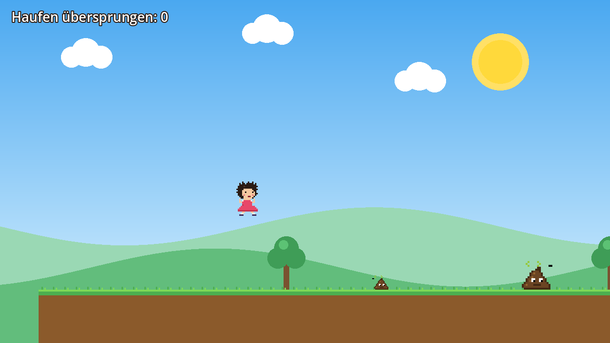

# Poorun

Ein kleines 2D-Jump-and-Run im Retro-Pixel-Look, entstanden als Projektarbeit
in der Lehrveranstaltung *Game & XR Design*.

Ein Mädchen mit zerzausten Haaren läuft durch eine Wiese und muss über
Hundehaufen springen. Wer reintritt, fliegt aus dem Bild und startet neu.
Jeder übersprungene Haufen gibt einen Punkt. Am Ende wartet die Zielfahne.



## Starten

1. [Godot Engine 4.7](https://godotengine.org/download) herunterladen
   (Standard-Version, kein .NET nötig) und entpacken.
2. Dieses Repository klonen oder als ZIP herunterladen.
3. Godot öffnen → **Importieren** → die Datei `project.godot` auswählen → **Importieren & Bearbeiten**.
4. Im Editor **F5** drücken (oder den Play-Button oben rechts).

Beim ersten Öffnen importiert Godot die Grafiken und die Musik automatisch,
das dauert ein paar Sekunden.

## Steuerung

| Aktion   | Tastatur                      |
|----------|-------------------------------|
| Laufen   | A / D oder Pfeil links/rechts |
| Springen | Leertaste, W oder Pfeil hoch  |
| Neustart nach dem Ziel | Enter           |

Tipp: Wer die Sprungtaste kurz drückt, springt niedriger, wer sie hält, höher.

## Projektstruktur

```
project.godot        Projekteinstellungen (Hauptszene, Input Map, Pixel-Filter)
scenes/
  main.tscn          Hauptszene: Hintergrund, Level, Spielerin, Musik, HUD
  level_1.tscn       Das Level: Plattformen, Haufen, Bäume, Ziel
  player.tscn        Spielerin (CharacterBody2D + Sprite + Kamera)
  poop.tscn          Hundehaufen (Area2D)
  platform.tscn      Plattform (StaticBody2D)
  goal.tscn          Zielfahne (Area2D)
  tree.tscn          Baum (nur Deko)
scripts/
  main.gd            Spielablauf: Punkte, Tod/Respawn, Ziel, Musik-Loop
  player.gd          Bewegung, Sprung, Laufanimation
  poop.gd            Animation, Kollision, Punkt beim Überspringen
  platform.gd        Zeichnet Erde und Gras, setzt die Kollisionsbox
  goal.gd            Zeichnet die Fahne, meldet das Ziel
  background.gd      Zeichnet Himmel, Sonne, Wolken, Hügel (einmalig)
  tree.gd            Zeichnet einen Baum
assets/
  girl.png           Spritesheet der Spielerin (6 Bilder à 16×24 px)
  poop.png           Spritesheet des Haufens (4 Bilder à 20×16 px)
  music.ogg          Hintergrundmusik
tools/
  make_sprites.py    Erzeugt girl.png und poop.png aus Text-"Pixelbildern"
  make_music.py      Erzeugt die Musik als Chiptune (WAV)
docs/
  Projektdokumentation.pdf
```

Die Szenen kommunizieren über Signals (`died`, `jumped_over`, `reached`) und
Groups (`player`, `poops`, `goal`), damit kein Skript ein anderes direkt kennen muss.

## Eigenes Level bauen

`scenes/level_1.tscn` im Editor öffnen. Plattformen, Haufen und Bäume lassen sich
per Duplizieren (Cmd/Strg+D) vervielfältigen und verschieben. Im Inspector:

- Plattform: `size` (Breite × Höhe in Pixel)
- Haufen: `size` (1 = klein, 2 = mittel, 3 = groß)

## Quellen

Alle Assets sind selbst erstellt, es werden keine fremden Dateien verwendet.

- **Godot Engine 4.7.2** – MIT-Lizenz, https://godotengine.org
- **Grafiken** (`girl.png`, `poop.png`) – selbst gezeichnet, generiert mit `tools/make_sprites.py` (Python + Pillow)
- **Musik** (`music.ogg`) – Melodie: *Korobeiniki*, russisches Volkslied (19. Jh., gemeinfrei);
  Arrangement und Klangerzeugung selbst mit `tools/make_music.py` (Python + NumPy), nach OGG konvertiert mit FFmpeg
- **Hintergrund, Plattformen, Fahne, Bäume** – direkt im Code gezeichnet (`_draw()`)
- Icon `icon.svg` – Standard-Icon von Godot (MIT)

## Autor

David Strauss
