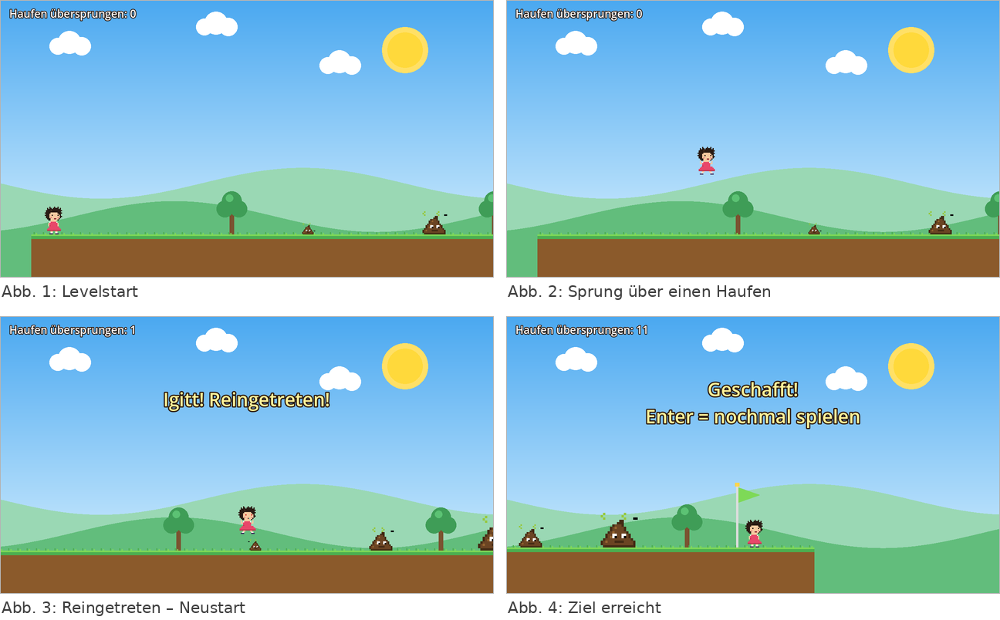

# Poorun – Projektdokumentation

**Lehrveranstaltung:** Game & XR Design – Projektarbeit „Creative Game & XR Experience"  
**Autor:** David Strauss  
**Technologie:** Godot Engine 4.7.2 (2D), GDScript  
**Repository:** https://github.com/DaStra3003/LV_Game_XR_Design_Poorun_DavidStrauss

---

## 1. Game Design Sheet

### Spielidee

*Poorun* ist ein kleines 2D-Jump-and-Run im Retro-Pixel-Look. Ein Mädchen mit dunklen, zerzausten Haaren und rosa Kleid läuft über eine Wiese, auf der jemand seinen Hund nicht aufgeräumt hat. Das einzige Hindernis im Spiel sind Hundehaufen in drei Größen. Wer drüberspringt, bekommt einen Punkt. Wer reintritt, fliegt mit einem „Igitt!" aus dem Bild und beginnt von vorne. Am Ende des Levels wartet eine Zielfahne.

Die Idee war bewusst simpel: ein einziges, sofort verständliches Hindernis, das jeder aus dem Alltag kennt, verpackt in einem fröhlichen Setting. Der Humor entsteht aus dem Kontrast zwischen der heilen Pixel-Wiese und dem, was darauf liegt. Statt vieler Mechaniken wollte ich eine Mechanik, nämlich das Sprung-Timing, sauber umsetzen und ihr durch Animation, Musik und Feedback Charakter geben.



### Zielgruppe

Gelegenheitsspieler jeden Alters, die ein kurzes Spiel für zwischendurch suchen. Die Steuerung besteht aus zwei Richtungen und einer Sprungtaste, ein Durchlauf dauert etwa eine Minute. Durch das harmlose Thema und den Cartoon-Look eignet sich das Spiel auch für Kinder.

### Core Gameplay Loop

1. **Laufen:** Die Spielerin bewegt sich nach rechts durch das Level, die Kamera folgt.
2. **Hindernis erkennen:** Ein Haufen kommt in Sicht. Größe und Abstand entscheiden, wann abgesprungen werden muss.
3. **Springen:** Die Sprunghöhe hängt davon ab, wie lange die Taste gehalten wird. Das erlaubt knappe Sprünge über kleine Haufen und hohe Sprünge auf Plattformen.
4. **Ergebnis:** Übersprungen – der Punktestand erhöht sich um eins. Reingetreten oder in ein Loch gefallen – die Figur wird nach oben geschleudert, fällt aus dem Bild, eine Meldung erscheint, und nach 1,5 Sekunden startet das Level mit Punktestand 0 neu.
5. **Ziel:** Die Fahne wird grün, „Geschafft!" erscheint, mit Enter startet man neu.

Der Loop ist kurz und bestraft Fehler schnell, ohne zu frustrieren, weil ein Neustart nur Sekunden kostet. Schwieriger wird es durch dichter stehende Haufen, Kombinationen aus großem und kleinem Haufen direkt hintereinander und zwei schwebende Plattformen in der Levelmitte.

### Steuerung

| Aktion | Tastatur | Gamepad |
|---|---|---|
| Laufen links/rechts | A / D oder Pfeiltasten | linker Stick |
| Springen | Leertaste, W oder Pfeil hoch | A-Taste |
| Neustart nach dem Ziel | Enter | – |

Die Belegung ist in der Godot Input Map (`project.godot`, Abschnitt `[input]`) definiert und wird im Code nur über die Aktionsnamen `move_left`, `move_right` und `jump` abgefragt.

### Feedback und Spielgefühl

- **Variable Sprunghöhe:** Beim Loslassen der Sprungtaste wird die Aufwärtsgeschwindigkeit halbiert. Kurzes Tippen ergibt einen kleinen Hüpfer, Halten einen vollen Sprung von etwa 185 Pixeln.
- **Animation:** Die Spielerin hat sechs Bilder (stehen, drei Laufbilder, springen, getroffen). Die Haufen wackeln und haben eine kreisende Fliege. Alles andere in der Welt steht still, damit die Haufen als einzige bewegte Elemente sofort ins Auge fallen.
- **Tod im Mario-Stil:** Nach dem Treffer verliert die Figur ihre Kollision, springt kurz hoch und fällt durch den Boden aus dem Bild.
- **Musik:** Eine selbst erzeugte Chiptune-Version des Volkslieds *Korobeiniki* (bekannt als Tetris-Melodie) läuft in Endlosschleife.

---

## 2. Technische Architektur

### Technologie

Ich habe mich für Godot 4.7 (2D) mit GDScript entschieden, weil das Node- und Szenensystem genau zu einem Plattformer passt: Jedes Spielelement ist eine eigene kleine Szene, die im Level beliebig oft instanziert werden kann. Die eingebaute 2D-Physik (`CharacterBody2D`, `StaticBody2D`, `Area2D`) nimmt mir Kollision und Schwerkraft ab, sodass der eigene Code sich auf Spiellogik beschränkt.

### Szenenstruktur

```
Main (Node2D)                          main.gd – Spielablauf
├── BackgroundLayer (CanvasLayer, -10)
│   └── Background (Node2D)            background.gd – Himmel, Sonne, Wolken, Hügel
├── Level (Instanz von level_1.tscn)
│   ├── Ground1..3, Float1..2          platform.tscn – StaticBody2D
│   ├── Poop1..11                      poop.tscn – Area2D, Gruppe "poops"
│   ├── Tree1..6                       tree.tscn – Deko
│   └── Goal                           goal.tscn – Area2D, Gruppe "goal"
├── Player (Instanz von player.tscn)   CharacterBody2D, Gruppe "player"
│   ├── CollisionShape2D
│   ├── Sprite2D (Spritesheet, hframes = 6)
│   └── Camera2D (folgt mit Smoothing)
├── Music (AudioStreamPlayer, autoplay)
└── HUD (CanvasLayer)
    ├── Score (Label)
    └── Message (Label)
```

Das Level ist eine eigene Szene ohne Skript. Es besteht nur aus platzierten Instanzen; neue Level lassen sich damit komplett im Editor bauen, ohne Code anzufassen.

### Key-Klassen

| Szene / Skript | Node-Typ | Aufgabe | Signale |
|---|---|---|---|
| `player.gd` | CharacterBody2D | Schwerkraft, Laufen, Springen, Laufanimation, Tod und Respawn | sendet `died` |
| `poop.gd` | Area2D | Wackel-Animation, Kollision mit der Spielerin, erkennt Überspringen | sendet `jumped_over`, empfängt `body_entered` |
| `platform.gd` | StaticBody2D | Zeichnet Erde und Gras, setzt die Kollisionsbox passend zu `size` | – |
| `goal.gd` | Area2D | Zeichnet die Fahne, meldet das Erreichen | sendet `reached` |
| `main.gd` | Node2D | Verbindet alle Signale, zählt Punkte, zeigt Meldungen, startet neu | empfängt `died`, `jumped_over`, `reached` |
| `background.gd`, `tree.gd` | Node2D | Reine Deko, einmalig gezeichnet | – |

### Kommunikation über Signals und Groups

Kein Spielelement kennt ein anderes direkt. Die Spielerin weiß nicht, was ein Haufen ist, und ein Haufen weiß nicht, dass es Punkte gibt. Stattdessen:

Jede Szene **sendet ein Signal**, wenn etwas Relevantes passiert (`died`, `jumped_over`, `reached`). `main.gd` sammelt beim Start alle Haufen über die Gruppe `poops` und verbindet ihre Signale:

```gdscript
for poop in get_tree().get_nodes_in_group("poops"):
    poop.jumped_over.connect(_on_jumped_over)
```

Die Haufen finden die Spielerin über die Gruppe `player`, um zu prüfen, ob sie vorbei ist. Dasselbe gilt für die Kollision: `body_entered` liefert den Körper, und `body.is_in_group("player")` entscheidet, ob er stirbt.

Der Vorteil zeigte sich beim Testen: Ich konnte Haufen im Editor hinzufügen, löschen und verschieben, ohne eine Zeile Code zu ändern. Auch die Anzahl der Haufen ist nirgends fest eingetragen.

### Grafik: Pixel-Sprites und `_draw()`

Für Spielerin und Haufen verwende ich **Spritesheets** (`girl.png` mit 6 Bildern à 16×24 px, `poop.png` mit 4 Bildern à 20×16 px). Ein `Sprite2D` mit `hframes` zeigt jeweils ein Bild, der Frame wird im Skript gesetzt. Damit die Pixel scharf bleiben, steht der Texturfilter des Projekts auf *Nearest*. Die Blickrichtung wird nur über `flip_h` gespiegelt, es gibt keine zweiten Bilder für links.

Hintergrund, Plattformen, Bäume und Fahne haben keine Bilddateien, sondern werden in `_draw()` mit `draw_rect`, `draw_circle` und `draw_colored_polygon` gezeichnet. Die Skripte sind mit `@tool` markiert, damit man die Elemente auch im Editor sieht. Die Plattform passt ihre Kollisionsbox über einen Setter automatisch an, wenn man `size` im Inspector ändert.

### Asset-Pipeline

Beide Spritesheets und die Musik entstehen aus Python-Skripten im Ordner `tools/`. Die Sprites sind dort als Text „gemalt" (ein Buchstabe pro Pixel), die Musik wird aus einer Notenliste als Rechteckwellen berechnet. So ist nachvollziehbar, dass alle Assets selbst erstellt sind, und Änderungen lassen sich jederzeit reproduzieren.

---

## 3. Learnings & Challenges

### Was gut funktioniert hat

**Szenen als Bausteine.** Die Entscheidung, jedes Element als eigene Szene zu bauen, hat sich sofort ausgezahlt. Das Level besteht nur aus Instanzen und Positionen, und ich konnte es im Editor zusammenschieben wie mit Legosteinen.

**Signals statt direkter Verweise.** Anfangs hätte ich die Punkte wohl direkt im Haufen-Skript hochgezählt. Mit Signalen bleibt die Logik an einer Stelle (`main.gd`), und die Haufen sind wiederverwendbar, auch wenn ein späteres Level ganz andere Regeln hat.

**Weniger ist mehr.** Eine frühere Version hatte eine komplett per Code gezeichnete, animierte Figur mit wehenden Haaren, flatterndem Kleid und Squash-and-Stretch, dazu eine Welt, in der sich Gras, Wolken und Sonnenstrahlen bewegten. Das war technisch interessant, aber das Skript für die Figur allein war über 200 Zeilen lang, und das Bild wirkte unruhig. Der Wechsel auf kleine Pixel-Sprites hat den Code auf ein Drittel reduziert und das Spiel optisch klarer gemacht: Jetzt bewegen sich nur die Haufen, also genau das, worauf man achten muss.

### Hürden

**Sprunghöhe.** Nach dem Einbau der Schwebeplattformen kam die Figur nicht hinauf. Die Sprunghöhe lässt sich aus Sprunggeschwindigkeit und Schwerkraft berechnen (h = v² / 2g): Mit 620 px/s und 1600 px/s² waren es nur 120 Pixel, die Plattform lag aber 130 Pixel hoch. Mit 760 px/s sind es rund 180 Pixel. Ich habe die Höhe danach im laufenden Spiel gemessen, statt zu raten.

**Asset-Import.** Godot importiert neue Dateien nur, wenn der Editor sie sieht. Als ich die PNGs per Skript in den Ordner gelegt und das Spiel direkt gestartet habe, waren Spielerin und Haufen unsichtbar, ohne Fehlermeldung. Erst nach dem Öffnen des Editors wurden die `.import`-Dateien erzeugt. Das hat mich einige Zeit gekostet, bis ich verstanden hatte, dass nicht der Code das Problem war.

**Ein verschobener Node.** Beim Arbeiten im Editor habe ich den `Level`-Node versehentlich um ein paar Pixel verschoben. Dadurch stand die Spielerin beim Start acht Pixel über dem Boden und alle Haufen waren gegenüber meinen Levelkoordinaten um 281 Pixel versetzt. Die Spielerin starb an einer Stelle, an der laut Szenendatei gar kein Haufen war. Gefunden habe ich den Fehler erst, nachdem ich die globalen Positionen aller Haufen in eine Datei geschrieben hatte. Lektion: Bei unerklärlichen Kollisionen zuerst die Transformationen der Elternknoten prüfen.

**Punkte zählen.** Das Überspringen erkenne ich nicht über eine Kollision, sondern indem jeder Haufen in `_process` prüft, ob die Spielerin rechts an ihm vorbei ist. Das ist einfach, aber nicht ganz sauber, weil der Haufen dafür die Spielerin über die Gruppe suchen muss. Eine zweite `Area2D` hinter jedem Haufen wäre die „godot-typischere" Lösung gewesen.

### Was ich beim nächsten Mal anders machen würde

- Checkpoints statt Neustart am Levelanfang, damit das Level länger sein kann.
- Sound-Effekte für Sprung, Treffer und Ziel; momentan gibt es nur Musik.
- Eine zweite Mechanik, die zur Idee passt, etwa einen Hund, der vor der Spielerin herläuft und neue Haufen legt, sodass das Level dynamisch entsteht.
- Früher einen Titelbildschirm mit Steuerungserklärung einbauen.

---

## 4. Quellenverzeichnis

Alle im Spiel verwendeten Grafiken und Töne wurden selbst erstellt. Es wurden keine fremden Asset-Dateien verwendet.

| Asset / Bibliothek | Herkunft | Lizenz |
|---|---|---|
| Godot Engine 4.7.2 | https://godotengine.org | MIT |
| `assets/girl.png`, `assets/poop.png` | selbst gezeichnet, erzeugt mit `tools/make_sprites.py` (Python 3, Pillow) | eigenes Werk |
| `assets/music.ogg` | Melodie: *Korobeiniki*, russisches Volkslied (19. Jahrhundert, gemeinfrei). Arrangement und Klangerzeugung selbst mit `tools/make_music.py` (Python 3, NumPy), Konvertierung nach OGG mit FFmpeg | Melodie gemeinfrei, Arrangement eigenes Werk |
| Hintergrund, Plattformen, Bäume, Fahne | direkt in GDScript gezeichnet (`_draw()`) | eigenes Werk |
| `icon.svg` | Standard-Projekt-Icon von Godot | MIT |
| Pillow, NumPy | Python-Bibliotheken, nur zum Erzeugen der Assets, nicht im Spiel enthalten | HPND / BSD |
| FFmpeg | nur zur Konvertierung WAV → OGG | LGPL |

Dokumentation der Godot Engine: https://docs.godotengine.org/en/stable/ (Abschnitte zu `CharacterBody2D`, Signals, Groups und `CanvasItem._draw()`).
